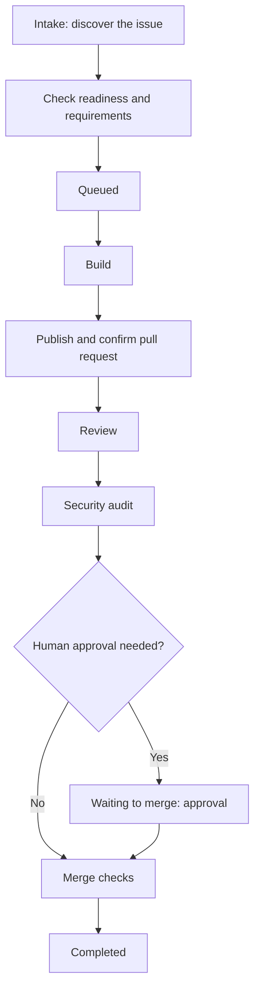
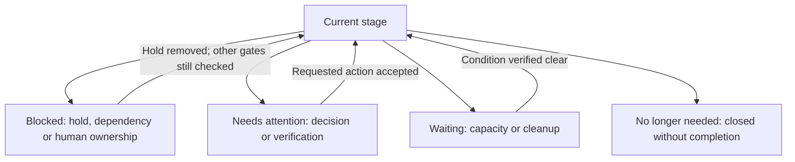
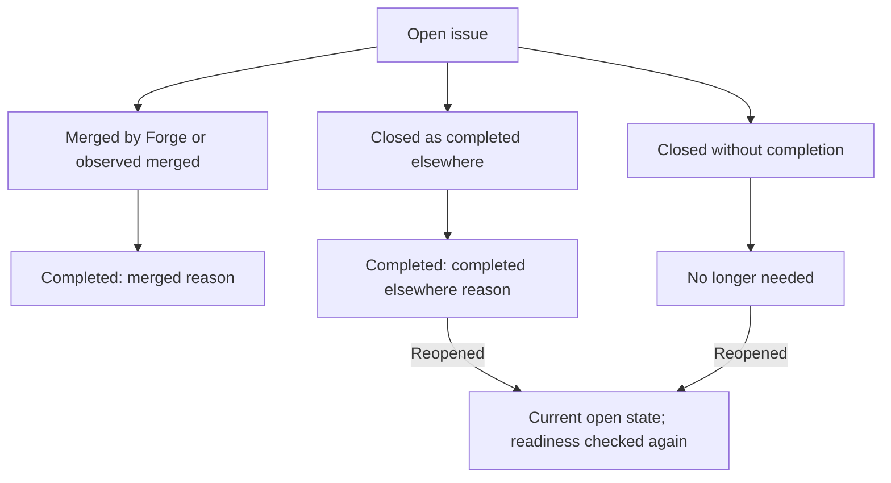

# How an issue moves

An issue moves through Build, Review and Audit before Forge can merge it. Activity, Issues and the issue panel share the same main status; the reason underneath tells you what it is doing or what must change.

Intake checks readiness; it is not a separate AI triage worker. An issue must be ready in an enabled repository, with no blocking requirement, before it can take a worker slot.

Forge verifies that a GitHub user applied the ready label after the last edit to an
issue's title or description. If the issue changes during a delivery, Forge
keeps the approved text pinned and pauses work on the changed requirements.
Review the edit and remove and reapply the ready label for a standalone issue.
Changes to issues in an approved grouped delivery require a membership decision.

## Read the factory line

The bays show **Queued**, **Build**, **Review**, **Security audit**, **Waiting to merge** and **Merged**. Side groups show **Needs attention**, **Waiting on other issues** and **On hold**.

The bay is the stage, not the main status. For example, an issue can have Review as its current stage while its badge says **Blocked** and the reason names a hold.

| Main status | What it means |
| --- | --- |
| Backlog | Not admitted, paused by the operator or moved back to the backlog. |
| Queued | Ready for its next worker. |
| Working | A worker, publication, cleanup, result check or merge step is in progress. |
| Waiting | Waiting for capacity or an external prerequisite. |
| Blocked | A dependency, hold or human ownership prevents progress. |
| Needs attention | A person must decide, verify or repair something. |
| Completed | Merged, or closed as completed elsewhere; the reason distinguishes them. |
| No longer needed | Closed without completion, such as not planned. |

## When progress stops

A hold does not erase a dependency. Removing a hold label resumes work only when the remaining conditions also allow it; repository setup becoming ready is rechecked automatically.

A worker may still be visible while **Blocked**: Forge can be stopping it or collecting its result. **Working — Cleaning up a finished attempt** and **Working — Checking the completed worker result** are not new failures.

The small attention labels point to the next action:

| Code | UI label | Your next step |
| --- | --- | --- |
| `approve` | approve | Review the current pull request on GitHub. |
| `verify` | verify | Complete the requested human check and record it. |
| `question` | question | Answer the worker's question in the retry decision. |
| `approach` | new approach | Explain a different approach before retrying. |
| `failed` | retry | Read the findings, then choose whether to retry. |
| `env` | fix setup | Repair the named account, host or repository problem. |
| `review` | review | Revisit an action paused or changed while being applied. |

## Open the workbench

Open an issue to see the latest summary, candidate pull request, checks and available actions. Use **Discuss blocker** when you want help understanding the evidence; asking a question alone changes nothing.

Forge investigates each charged failure, including the third. After the budget is exhausted, an explicit retry needs a new approach; unavailable infrastructure and provider cooldowns do not consume those code-failure attempts.

## Completion and reopening

Reopening removes the old completion from the current status. It does not silently reuse an obsolete approval or merge result; an untracked reopened issue returns to Backlog until admitted.

Next: [Talking to a worker](issue-conversations.md) or [Workers, accounts and merging](factory-runtime.md). The [status reference](operator-status.md) describes the API fields and the [store design](store-foundation.md) describes lifecycle records.
